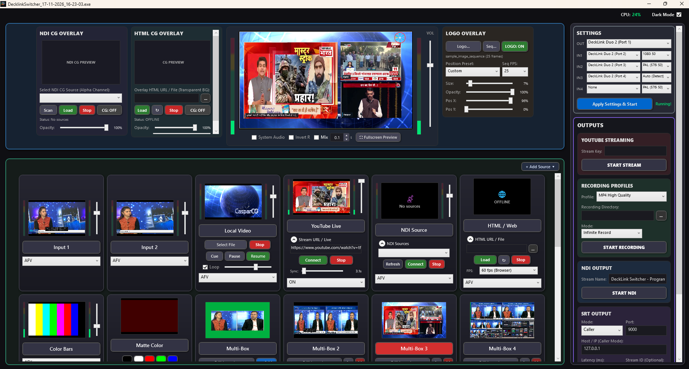

# DeckLink Switcher


A lightweight and efficient WPF application designed for Blackmagic DeckLink devices. It serves as an intuitive multi-input video switcher with built-in test signals, local media playback, independent screen and webcam multiview tiles, PC system audio loopback capture, and a fully featured software audio mixer.

## Features

*   **Live Video Routing:** Connect to multiple DeckLink inputs and route them dynamically to a primary DeckLink output with active tally indicators.
*   **Full Audio Mixer:** Includes an integrated digital audio mixer with Green/Yellow/Red segmented VU meters allowing you to set independent levels and mix modes (AFV, ON, OFF) for all inputs, local media, webcams, HTML/Web, YouTube Live, system audio, and test tones.
    *   **Dynamic Local Microphones:** Automatically detects all connected local audio inputs (microphones, USB capture cards, line-in) and dynamically builds a dedicated mixing channel strip for every active device on your PC. *Includes robust audio buffering and MMDeviceEnumerator integration for full device name support without truncation.*
*   **Live Previews & Click-to-Switch:** Visual multiviewer previews of all input sources side-by-side. Change the program output by clicking directly on any input's video preview thumbnail or its Cut button. Active sources illuminate with a prominent red tally (`#d32f2f`).
*   **Independent Dedicated Webcam Tiles:**
    *   **Multi-Webcam Multiviewer:** Automatically detects **all** connected USB webcams, virtual cameras (e.g., OBS Virtual Camera), and HDMI USB capture dongles, creating an **independent switcher tile for every webcam**.
    *   **Live Monitoring & Dedicated Controls:** Each webcam tile features its own live preview thumbnail, dedicated Cut button, dual peak VU meters (L/R), volume fader, and an audio mode selector (AFV / ON / OFF).
    *   **Proportional 1080p Scaling & Letterboxing:** Automatically scales and letterboxes arbitrary webcam resolutions (e.g., 720p, 480p, 4:3, 16:9) cleanly into the 1080p broadcast frame.
    *   **Session Isolation & Anti-Flicker:** Built-in session tokens and device locks eliminate frame collisions, flickering, or cross-camera frame bleeding when switching.
    *   **Integrated Microphone Linking:** Automatically associates each webcam's built-in microphone with its respective tile.
*   **Dedicated Computer Screen Tiles:**
    *   **Independent Multiviewer Per Screen:** Discovers all connected computer monitors and creates a dedicated switcher tile for each screen (**Screen 1**, **Screen 2**, etc.).
    *   **Continuous Real-Time Previews:** Optimized background capture loops update every screen's preview thumbnail at 25 fps with zero UI stutter.
    *   **Proportional Letterboxing & Anti-Aliasing:** Preserves text crispness by intelligently letterboxing non-standard monitor resolutions into the 1080p broadcast frame with 4:2:2 chroma-smoothing.
*   **System Audio as a Source (PC Audio Loopback):**
    *   **WASAPI Loopback Capture:** Captures desktop audio in real-time from Windows applications (browsers, YouTube, Zoom, media players, games) directly into the broadcast mix.
    *   **Dedicated Mixer Tile:** Features dual peak VU meters, a volume fader (0.0 to 1.5), and an on-tile audio output device selector (Default Audio Output, Headphones, Speakers).
    *   **AFV Support for Screens:** In **AFV** mode, System Audio automatically unmutes whenever any computer screen is switched to Program, and mutes when cutting away. In **ON** mode, it remains continuously mixed into Program for background music or alerts.
    *   **Universal Format Conversion:** Converts arbitrary system audio formats (32-bit float, 16/24/32-bit PCM, 44.1 kHz, 48 kHz, 96 kHz, surround) into broadcast-standard **48 kHz 16-bit stereo PCM**.
    *   **Decay & Silence Detection:** Meters smoothly decay and reset to zero when system audio pauses or is idle.
*   **YouTube Live Stream as a Source:**
    *   **Direct YouTube Live Ingestion:** Connect to any public YouTube Live broadcast URL (or direct HLS `.m3u8` link) and ingest it directly as an active broadcast source.
    *   **Dedicated Multiview Tile with Expandable URL Input:** Expandable stream URL input directly on the tile allows pasting live links on the fly, with one-click **Connect** / **Stop** controls and real-time status indicators (`OFFLINE`, `Resolving...`, `LIVE`, `Buffering...`).
    *   **Automatic PTS-Based A/V Sync:** Powered by `YoutubeExplode` and LibVLC, decoding full 1080p UYVY broadcast video and 48kHz 16-bit stereo PCM audio with automatic presentation-timestamp (`libvlc_clock`) pacing so audio stays locked in sync without manual delay tuning.
    *   **Full Switcher & Mixer Integration:** Switch between YouTube Live and other inputs via the "YouTube Live" button or preview click. Supports dedicated L/R VU meters, volume fader, and AFV / ON / OFF audio modes.
*   **HTML / Web as a Source:**
    *   **Live Web & Local HTML Ingestion:** Powered by **CefSharp.OffScreen** (`1920×1080` offscreen Chromium with D3D11 shared-texture accelerated rendering at 60 fps), load any web URL (`https://...`) or local `.html` file as a switcher source.
    *   **Smooth Frame Capture & 1080i Deflicker:** Applies a `1080i` vertical `1-2-1` broadcast deflicker filter for clean scrolling tickers and text on interlaced DeckLink outputs.
    *   **Audio & Transport Controls:** Includes Load, Reload (`↻`), Stop, and AFV / ON / OFF audio routing.
*   **Dynamic Source Panel (`+ Add Source ▾`):**
    *   **Add Extra Sources On the Fly:** Dynamically add independent **Matte Color**, **HTML / Web Page**, **YouTube Live / Video** (auto-connects on startup when a URL is saved), **NDI Source**, **SRT Stream** (with full Caller/Listener, Port, Host/IP, Latency, Stream ID, and Passphrase settings), **Media / Video File** (with unified Pause/Resume toggle), and **Multi-Box Scene** tiles directly in the switcher panel. Every audio source displays a live gain percentage (`%`) label under its fader.
    *   **Rename & Remove:** Rename any dynamic source or Multi-Box scene via `✎` (or double-click), automatically updating Multi-Box layer references, or remove with `✕`.
*   **PGM Overlays (Live Compositing onto Program Output):**
    *   **PGM HTML CG Overlay:** Dedicated transparent-background CefSharp CG overlay (left of Program Output, **60 fps** by default) with live preview, Load/Reload/Stop, `CG: ON/OFF`, Opacity slider (`10%–100%`), live FPS selector (`15–60 fps`), and `1080i` alpha-weighted vertical deflicker.
    *   **PGM NDI CG Overlay:** Scan and composite alpha-channel NDI CG feeds (including local NDI Out) directly onto PGM with live preview, `CG: ON/OFF`, and Opacity control.
    *   **PGM Logo Overlay:** Overlay static logos (`.png`, `.webp`, `.bmp`, `.jpg`), animated **video logos / GIFs** (`.mp4`, `.mov`, `.webm`, `.mkv`, `.avi`, `.gif` via `Logo...`, decoded via bundled FFmpeg with alpha-channel preservation up to 240 frames), or **image sequence folders** (via `Seq...`) onto PGM with `LOGO: ON/OFF`, **Seq FPS** (`10–60 fps`), Position Presets (`Top-Right`, `Top-Left`, `Bottom-Right`, `Bottom-Left`, `Center`, `Custom`), Size (`3%–50%`), Opacity (`10%–100%`), and X/Y sliders.
*   **NDI Input & Output:**
    *   **NDI Source:** Discover and ingest local NDI video/audio streams directly as a switcher tile.
    *   **NDI Output:** Zero-configuration Network Device Interface (NDI) Program feed output for local broadcast networks.
*   **Local Media Playback:** Powered by LibVLC, load and play local video files (MP4, MKV, AVI, etc.) directly into the switcher's program output.
    *   **Image Support:** Also supports routing static images (JPG, PNG, BMP) seamlessly into the broadcast.
    *   **Loop Mode:** Features a toggleable gapless playback loop for continuous playback of a selected file.
*   **Multi-Box / Composite Source:** Combine multiple live inputs (DeckLink, Screen, Webcam, Media, YouTube, HTML, NDI, Color Bars, and dynamically added sources) into one or more independent `1920×1080` switcher tiles. Editing a non-active Multi-Box scene does not disturb live PGM output.
    *   **Visual Layout & In-Place Crop Editor:** Open **Edit Layout...** to drag/resize boxes visually on a live `480×270` canvas, switch to **Crop Edges** mode to drag Left/Top/Right/Bottom crop handles (`0–98%`, in-place masking without stretching), dynamically **+ Add Box** or remove (`✕`) layers, reorder Z-order (`▲`/`▼`), adjust borders, pick a background color, or apply **Standard Presets** (**2-Up**, **PiP**, **3-Box**, **2×2 Quad**) and **Crop Presets** (**2-Split L/R**, **2-Split Top/Bot**, **2-Mid / 3-Mid Center Crop**, **3-Col / 4-Col Split**, **Center Box**).
    *   **Animated Multi-Caption Box Titles:** Add a **Title / Name** to any box to render a sleek lower-third pill inside that box; separate multiple captions with `$$` to cycle through them one by one in a 5-second left-to-right text wipe reveal loop while keeping the background pill steady.
*   **Fullscreen Preview:** Output a crisp `1920×1080` Full HD Program feed (including all overlays) to a secondary monitor or current display via **`⛶ Fullscreen`**, **double-clicking** the PGM preview, or pressing **`F11`** (exit with **`ESC`**, **`F11`**, or double-click).
*   **Transitions & Stingers (`Cut`, `Mix`, `Wipe`, `Box Out`, `Stinger`):** Use the transition selector and duration spinner (`0.1–10.0 s`) below Program Output to choose between instant **Cut**, smooth **Mix** dissolve, directional **Wipes** (`Wipe L→R`, `Wipe R→L`, `Wipe T→B`, `Wipe B→T`), **Box Out**, or **Stinger** (load any alpha-channel PNG/image sequence folder via **`📁`** for broadcast stinger transitions with midpoint cut). All non-Cut transitions include synchronized AFV audio crossfading across both the in-app preview and 1080p broadcast outputs.
*   **Synthetic Sources:**
    *   **Color Bars + Tone:** Generate an 8-stripe SMPTE-style UYVY color bar pattern with a perfectly synchronized, phase-continuous 1kHz sine wave audio tone for calibrating equipment.
    *   **Matte Color Generator:** Send a full-screen solid matte color directly to the output using the on-tile **Color Swatch Grid** (9 instant presets + **`...`** custom RGB color picker).
*   **System Audio Monitor:** Listen to the active PGM audio output directly through your PC's speakers or headphones, even if no DeckLink output hardware is present.
*   **SRT Input & Output:**
    *   **SRT Input Source (Built-in & Dynamic):** Receive live `srt://` feeds (Caller or Listener) via bundled FFmpeg with full **SRT Settings** (Mode, Port, Host/IP, Latency, Stream ID, Passphrase, auto-built URL), L/R meters, gain slider + `%` label, and `AFV / ON / OFF`.
    *   **SRT Streaming Output:** Low-latency live broadcast streaming via Secure Reliable Transport (SRT) over MPEG-TS. Supports both **Caller** mode (push to remote decoders, ingest servers, or cloud platforms) and **Listener** mode (listen locally on a port for decoders/vMix/OBS to pull), configurable latency buffer, optional Stream ID, and AES encryption passphrase.
*   **YouTube (1 & 2) & Facebook Live Streaming:** Simultaneous direct streaming to **YouTube Streaming**, **YouTube Streaming 2**, and **Facebook Streaming** (`rtmps://live-api-s.facebook.com:443/rtmp/`), each with configurable Server URL & Stream Key, `Stopwatch`-paced CFR 1080p25 delivery (`4500k` / `9000k` VBV) to prevent buffering, elapsed timers, status badges (`● OFFLINE`, `● CONNECTING`, `● LIVE`, `● ERROR`), and live FFmpeg `fps • kbps • speed` telemetry.
*   **Local Recording:** High-quality local recording of the program output directly to disk using bundled FFmpeg. Supports **Infinite Record** (continuous single file) and **Interval Record** (automatic time-segmented files) with configurable encoding profiles (MP4 H.264, XDCAM HD422, **XDCAM Sony Compatible** `.mxf` with 2 discrete 24-bit 48 kHz mono `pcm_s24le` audio tracks, TS, ProRes) tuned for broadcast and post-production.
*   **Customizable UI:** Drag-and-drop source tile reordering, Dark/Light mode toggle, and real-time CPU usage readout.
*   **Persistent Settings:** Your hardware routing, source order, audio mixer states, levels, overlay settings, stream key, recording profile, and preferences are automatically saved to `%APPDATA%\DecklinkSwitcher\decklink_switcher_settings.json` and restored on startup.
*   **Robust COM Handling:** Seamlessly interfaces with the Blackmagic DeckLink SDK using Multithreaded Apartment (MTA) threading.

## Prerequisites

*   Windows operating system (Windows 10 / 11 64-bit)
*   .NET 10.0 SDK (or higher)
*   Blackmagic Desktop Video software installed (provides the required `DeckLinkAPI.dll` COM interfaces)
*   NDI Runtime (`Processing.NDI.Lib.x64.dll`, required for NDI input, NDI output, and `PGM NDI CG Overlay`)
*   Supported Blackmagic DeckLink hardware (e.g., DeckLink Duo 2, Quad 2, 4K Extreme). *Note: The switcher can still function fully as a software switcher, screen capture tool, media player, and audio mixer using your PC monitor even without physical DeckLink hardware.*

## Building the Application

To build the application locally:

1. Clone this repository.
2. Ensure you have the .NET SDK installed.
3. Run the build script in the project directory:

```powershell
powershell -ExecutionPolicy Bypass -File .\build.ps1
```

This stops any running instance of the app, compiles the project in **Release** mode (pass `-Configuration Debug` for Debug), removes previous builds, and outputs a timestamped executable (`DecklinkSwitcher_dd-MM-yyyy_HH-mm-ss.exe`) in `bin\Release\net10.0-windows\win-x64\`.

## Usage

1. Open the generated `DecklinkSwitcher_dd-MM-yyyy_HH-mm-ss.exe` from `bin\Release\net10.0-windows\win-x64\`.
2. Select your designated **Output Device** from the right-side control panel (or select "None" to operate in software-only mode).
3. Map your physical DeckLink inputs to **Input 1**, **Input 2**, etc.
4. Click **Apply Settings & Start**. The switcher initializes hardware feeds and activates the multiview panel.
5. **Switching Sources & Transitions:** Click on any input's preview thumbnail or Cut button (**Input**, **Screen 1/2**, **Webcam 1/2**, **YouTube Live**, **HTML / Web**, **NDI**, **Media**, **Color Bars**, **Matte**, **Multi-Box**) to switch it to Program output. Choose **Cut**, **Mix**, **Wipe L→R / R→L / T→B / B→T**, **Box Out**, or **Stinger** (with a **`📁`** PNG sequence folder) from the transition selector and adjust the duration (`0.1–10.0 s`). Drag tiles to reorder them.
9. **Multi-Box Layout:** On any **Multi-Box** tile, click **Edit Layout...** to add/remove boxes, pick sources, enter **Title / Name** captions (use `$$` to cycle multiple captions), choose presets/background color, or drag boxes and **Crop Edges** handles directly on the live preview.
10. **Dynamic Sources (`+ Add Source ▾`):** Add extra **Matte**, **HTML**, **YouTube**, **NDI**, **SRT**, **Media**, or **Multi-Box** tiles directly in the source panel, rename them via `✎`, and remove them with `✕`.
11. **Screen Capture:** Each detected computer monitor displays as an individual tile (**Screen 1**, **Screen 2**, etc.). Cut to any screen to send it to Program or use it inside Multi-Box scenes.
12. **Webcams:** Each detected webcam has its own dedicated tile with live video, VU meters, volume fader, and AFV/ON/OFF audio control.
13. **System Audio:** Use the **System Audio** tile to capture your PC's audio playback (YouTube, Zoom, music). Select your audio device, adjust the volume slider, and set the mode to **AFV** (follows screen capture) or **ON** (always mixed).
14. **Audio Mixer:** Adjust volume faders (with live `%` labels) and define audio modes (**AFV** - Audio Follows Video, **ON**, **OFF**) for every channel.
15. **Local Video:** Load media files with **Select File**, use **Cue**, unified **Pause / Resume**, and toggle **Loop**.
16. **YouTube & SRT Sources:** On **YouTube** or **SRT** tiles, paste a URL (or configure SRT Caller/Listener settings) and click **Connect**.
17. **HTML / Web Source:** On any **HTML / Web** tile, enter a URL or browse for a local `.html` file and click **Load**, then cut to the tile to send it to Program.
18. **PGM Overlays:** Use the **PGM NDI CG OVERLAY** / **PGM HTML CG OVERLAY** panels on the left of Program Output to load and toggle live CG overlays, and **PGM LOGO OVERLAY** on the right to load a static image or animated video/GIF (`Logo...`) or image sequence folder (`Seq...`), set **Seq FPS**, adjust position/size/opacity, and toggle `LOGO: ON/OFF`.
19. **Streaming, Fullscreen & NDI:** Click **`⛶ Fullscreen`** (or double-click the PGM preview / press `F11`) for 1080p monitor output; configure Server URL + Stream Key on **YouTube Streaming**, **YouTube Streaming 2**, or **Facebook Streaming** and monitor live `fps • kbps • speed` telemetry; configure SRT Caller/Listener settings and click **START SRT**; or click **START NDI** to publish the Program feed over NDI.
20. **Recording:** Choose a recording profile (MP4, ProRes, XDCAM HD422, **XDCAM Sony Compatible** `.mxf`) and destination folder, then click **START RECORDING**.

## Documentation

*   [Operator Manual (Markdown)](OPERATOR_MANUAL.md)
*   [Operator Manual (PDF)](OPERATOR_MANUAL.pdf)
