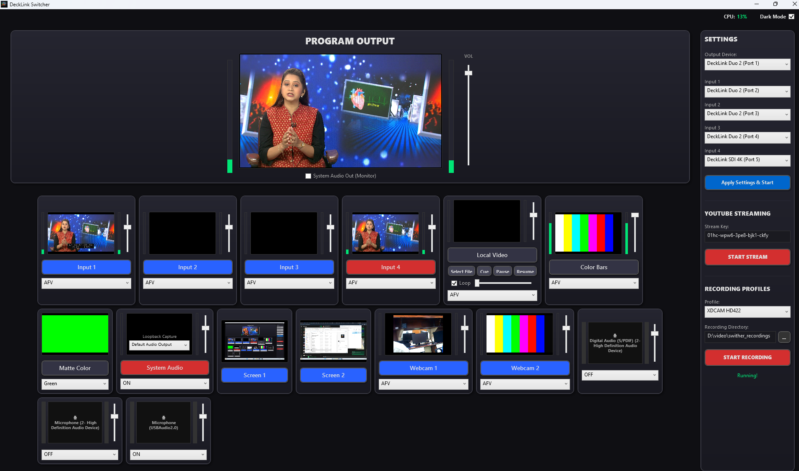

# DeckLink Switcher


A lightweight and efficient WPF application designed for Blackmagic DeckLink devices. It serves as an intuitive multi-input video switcher with built-in test signals, local media playback, independent screen and webcam multiview tiles, PC system audio loopback capture, and a fully featured software audio mixer.

## Features

*   **Live Video Routing:** Connect to multiple DeckLink inputs and route them dynamically to a primary DeckLink output with active tally indicators.
*   **Full Audio Mixer:** Includes an integrated digital audio mixer allowing you to set independent levels and mix modes (AFV, ON, OFF) for all inputs, local media, webcams, system audio, and test tones.
    *   **Dynamic Local Microphones:** Automatically detects all connected local audio inputs (microphones, USB capture cards, line-in) and dynamically builds a dedicated mixing channel strip for every active device on your PC. *Includes robust audio buffering and MMDeviceEnumerator integration for full device name support without truncation.*
*   **Live Previews & Click-to-Switch:** Visual multiviewer previews of all input sources side-by-side. Change the program output by clicking directly on any input's video preview thumbnail or its Cut button. Active sources illuminate with a prominent red tally (`#d32f2f`).
*   **Independent Dedicated Webcam Tiles:**
    *   **Multi-Webcam Multiviewer:** Automatically detects **all** connected USB webcams, virtual cameras (e.g., OBS Virtual Camera), and HDMI USB capture dongles, creating an **independent switcher tile for every webcam**.
    *   **Live Monitoring & Dedicated Controls:** Each webcam tile features its own live preview thumbnail, dedicated Cut button, dual peak VU meters (L/R), volume fader, and an audio mode selector (AFV / ON / OFF).
    *   **Proportional 1080p Scaling & Letterboxing:** Automatically scales and letterboxes arbitrary webcam resolutions (e.g., 720p, 480p, 4:3, 16:9) cleanly into the 1080p broadcast frame.
    *   **Session Isolation & Anti-Flicker:** Built-in session tokens and device locks eliminate frame collisions, flickering, or cross-camera frame bleeding when switching.
    *   **Integrated Microphone Linking:** Automatically associates each webcam's built-in microphone with its respective tile.
*   **Dedicated Computer Screen Tiles:**
    *   **Independent Multiviewer Per Screen:** Discovers all connected computer monitors and creates a dedicated switcher tile for each screen (**Screen 1**, **Screen 2**, etc.).
    *   **Continuous Real-Time Previews:** Optimized background capture loops update every screen's preview thumbnail at 25 fps with zero UI stutter.
    *   **Proportional Letterboxing & Anti-Aliasing:** Preserves text crispness by intelligently letterboxing non-standard monitor resolutions into the 1080p broadcast frame with 4:2:2 chroma-smoothing.
*   **System Audio as a Source (PC Audio Loopback):**
    *   **WASAPI Loopback Capture:** Captures desktop audio in real-time from Windows applications (browsers, YouTube, Zoom, media players, games) directly into the broadcast mix.
    *   **Dedicated Mixer Tile:** Features dual peak VU meters, a volume fader (0.0 to 1.5), and an on-tile audio output device selector (Default Audio Output, Headphones, Speakers).
    *   **AFV Support for Screens:** In **AFV** mode, System Audio automatically unmutes whenever any computer screen is switched to Program, and mutes when cutting away. In **ON** mode, it remains continuously mixed into Program for background music or alerts.
    *   **Universal Format Conversion:** Converts arbitrary system audio formats (32-bit float, 16/24/32-bit PCM, 44.1 kHz, 48 kHz, 96 kHz, surround) into broadcast-standard **48 kHz 16-bit stereo PCM**.
    *   **Decay & Silence Detection:** Meters smoothly decay and reset to zero when system audio pauses or is idle.
*   **Local Media Playback:** Powered by LibVLC, load and play local video files (MP4, MKV, AVI, etc.) directly into the switcher's program output.
    *   **Image Support:** Also supports routing static images (JPG, PNG, BMP) seamlessly into the broadcast.
    *   **Loop Mode:** Features a toggleable gapless playback loop for continuous playback of a selected file.
*   **Synthetic Sources:**
    *   **Color Bars + Tone:** Generate an 8-stripe SMPTE-style UYVY color bar pattern with a perfectly synchronized, phase-continuous 1kHz sine wave audio tone for calibrating equipment.
    *   **Matte Color Generator:** Send a full-screen solid matte color directly to the output. Supports on-the-fly switching between Black, White, Red, Green, Blue, Yellow, Cyan, and Magenta.
*   **System Audio Monitor:** Listen to the active PGM audio output directly through your PC's speakers or headphones, even if no DeckLink output hardware is present.
*   **YouTube Live Streaming:** Built-in direct streaming to YouTube Live via RTMP. Sends a high-quality 1080p25 H.264 stream using bundled FFmpeg. Features automatic fallback frames to keep the stream alive when no sources are active, and synchronized audio/video queues to prevent drift.
*   **SRT Streaming Output:** Low-latency live broadcast streaming via Secure Reliable Transport (SRT) over MPEG-TS. Supports both **Caller** mode (push to remote decoders, ingest servers, or cloud platforms) and **Listener** mode (listen locally on a port for decoders/vMix/OBS to pull), configurable latency buffer, optional Stream ID, and AES encryption passphrase.
*   **NDI Output:** Zero-configuration Network Device Interface (NDI) Program feed output for local broadcast networks.
*   **Local Recording:** High-quality local recording of the program output directly to disk using bundled FFmpeg. Includes configurable encoding profiles (MP4 H.264, MPEG-2 XDCAM HD422, ProRes, DNxHD) tuned for broadcast and post-production.
*   **Persistent Settings:** Your hardware routing, audio mixer states, levels, stream key, recording profile, and preferences are automatically saved to `%APPDATA%\DecklinkSwitcher\decklink_switcher_settings.json` and restored on startup.
*   **Robust COM Handling:** Seamlessly interfaces with the Blackmagic DeckLink SDK using Multithreaded Apartment (MTA) threading.

## Prerequisites

*   Windows operating system (Windows 10 / 11 64-bit)
*   .NET 10.0 SDK (or higher)
*   Blackmagic Desktop Video software installed (provides the required `DeckLinkAPI.dll` COM interfaces)
*   Supported Blackmagic DeckLink hardware (e.g., DeckLink Duo 2, Quad 2, 4K Extreme). *Note: The switcher can still function fully as a software switcher, screen capture tool, media player, and audio mixer using your PC monitor even without physical DeckLink hardware.*

## Building the Application

To build the application locally:

1. Clone this repository.
2. Ensure you have the .NET SDK installed.
3. Run the following command in the project directory:

```bash
dotnet build
```

The compiled application and its dependencies will be placed in the `bin/Debug/net10.0-windows/win-x64` directory.

## Usage

1. Open `DecklinkSwitcher.exe`.
2. Select your designated **Output Device** from the right-side control panel (or select "None" to operate in software-only mode).
3. Map your physical DeckLink inputs to **Input 1**, **Input 2**, etc.
4. Click **Apply Settings**. The switcher initializes hardware feeds and activates the multiview panel.
5. **Switching Sources:** Click on any input's preview thumbnail or Cut button (**Input**, **Screen 1/2**, **Webcam 1/2**, **Media**, **Color Bars**, **Matte**) to cut it to Program output. The active source button turns red.
6. **Screen Capture:** Each detected computer monitor displays as an individual tile (**Screen 1**, **Screen 2**, etc.). Cut to any screen to send it to Program.
7. **Webcams:** Each detected webcam has its own dedicated tile with live video, VU meters, volume fader, and AFV/ON/OFF audio control.
8. **System Audio:** Use the **System Audio** tile to capture your PC's audio playback (YouTube, Zoom, music). Select your audio device, adjust the volume slider, and set the mode to **AFV** (follows screen capture) or **ON** (always mixed).
9. **Audio Mixer:** Adjust volume faders and define audio modes (**AFV** - Audio Follows Video, **ON**, **OFF**) for every channel.
10. **Local Video:** Load media files with **Select File**, use **Cue**, **Pause**, **Resume**, and toggle **Loop**.
11. **Streaming:** Enter your YouTube Stream Key in the settings panel and click **START STREAM**.
12. **Recording:** Choose a recording profile (MP4, ProRes, XDCAM) and destination folder, then click **START RECORDING**.
